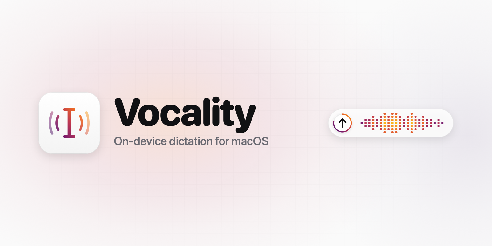

# Vocality



On-device dictation for macOS. Hold fn, speak, release: the text is pasted into the frontmost app, and Return can be pressed for you.

Speech recognition uses NVIDIA Parakeet TDT 0.6B v3 through [FluidAudio](https://github.com/FluidInference/FluidAudio) (CoreML, Apple Neural Engine). Audio never leaves the Mac.

## Usage

| Key | Action |
| --- | --- |
| fn (hold) | Record; release to paste |
| fn, fn (tap) | Start recording; tap again to stop |
| esc | Cancel |
| ⇧⌘E (menu bar) | Toggle Return after pasting |

Recordings stop and send automatically after 2 minutes; the ring around the send button shows the time used.

The first launch downloads the model (about 450 MB). Vocality needs Microphone and Accessibility permission.

If fn opens the emoji picker, set System Settings › Keyboard › Press 🌐 key to › Do Nothing.

## Install

Download `Vocality-3.1.0.zip` from [Releases](https://github.com/taylorle9212/Vocality/releases), unzip it and move `Vocality.app` to Applications. The build is not notarized: the first time, right-click the app and choose Open.

## Build

Requires macOS 15 and Xcode 16 or later.

```bash
make app       # builds and signs Vocality.app into ~/Downloads
make run       # builds, then opens it
make validate  # build + speech test + UI snapshots + HTML report
```

`scripts/bundle.sh` signs with your Apple Development identity if you have exactly one, and falls back to ad-hoc signing. Set `CODESIGN_IDENTITY` to choose one.

## Development workflow

1. Draft the change on a branch.
2. Run `make validate`. It builds, transcribes a generated speech clip and checks the text, then renders the settings window and every recorder state in light and dark mode to `build/validate/report.html`.
3. Review the report, fix, and re-run until it passes.
4. Commit and push.

## Layout

```
Sources/Vocality/
  VocalityApp.swift      app entry, menu bar, test flags
  AppModel.swift         record → transcribe → paste flow
  HotkeyMonitor.swift    fn and esc handling
  AudioCapture.swift     microphone capture, 16 kHz resampling
  Transcriber.swift      Parakeet model download, load and inference
  Paster.swift           paste, Return key, word fixes
  RecorderOverlay.swift  floating recorder and send animation
  MainView.swift         settings window
  Snapshot.swift         offscreen rendering for validation
  Settings.swift, Theme.swift
scripts/
  bundle.sh              builds the .app
  validate.sh            validation pipeline
  make-icon.swift        renders Resources/AppIcon.icns
```

## License

MIT. See [LICENSE](LICENSE).

Parakeet TDT 0.6B v3 is by NVIDIA (CC-BY-4.0). FluidAudio is Apache-2.0.
